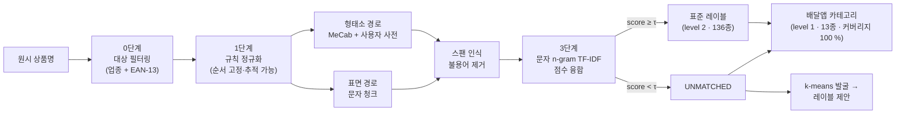

<div align="center">


# MenuNorm

**노이즈 상품명을 위한 한국어 2단계 표준화 파이프라인**

136개 표준 레이블 · 13개 배달앱 카테고리 · 카테고리 커버리지 100 % · 시드 기반 완전 재현

[](https://github.com/pmy02/Menunorm/actions)
[](pyproject.toml)
[](LICENSE)
[](paper/menunorm_ko.pdf)

[English](README.md) · **한국어**  |  [논문](paper/menunorm_ko.pdf) · [분류 체계 설계](docs/taxonomy.md) · [변경 이력](CHANGELOG.md)

</div>

---

```text
★양념 치킨 라지★         →  양념치킨       │ 치킨              1.00
[강남점] ♥하와이안피자♥   →  하와이안피자    │ 피자              1.00
불고고기 버거             →  불고기버거     │ 버거·패스트푸드    0.89   퍼지 매칭
♥부찌대개세트♥           →  UNMATCHED     │ 찜·탕·찌개        0.21   레이블은 보류,
                                                                    카테고리는 유지
```

판매자가 직접 입력한 상품명에는 장식 기호, 옵션 접미, 오타, 한·영 혼용이
뒤섞여 있습니다. **MenuNorm**은 이런 이름을 깨끗한 표준 레이블과 탐색용
카테고리로 사상하며, 무엇보다 **추측하지 말아야 할 때를 압니다** — 세부
레이블은 보류할 수 있고, 카테고리는 언제나 배정됩니다.

## 핵심 특징

- **한 번의 실행, 두 개의 레벨.** 거부 옵션을 갖춘 세부 레이블(136종)과 결코 보류하지 않는 굵은 카테고리(13종) — 어떤 행도 미분류로 남지 않습니다.
- **융합이 단일 토크나이저를 능가.** 형태소 경로(MeCab + 자동 컴파일 사용자 사전)와 표면 경로를 병렬 채점해 행 단위 최댓값을 채택합니다. 주장이 아니라 ablation으로 입증했습니다.
- **NDA에도 불구하고 검증 가능.** 원 데이터는 비공개이므로, 모든 수치를 누구나 명령 한 줄로 재생성 가능한 공개·결정적 벤치마크에서 측정했습니다.
- **속이기 어렵게 설계.** 지름길로 쓰일 열에 의도적으로 노이즈를 심고, 폐쇄 세계 상한을 명시하며, *hard* 트랙은 어떤 렉시콘도 모르는 오타를 주입합니다.

## 주요 결과

공개 벤치마크(20,000행, 시드 42) 측정치입니다. 의미 있는 쪽은 어떤
렉시콘도 커버하지 않는 글자 수준 오타를 추가한 **hard 트랙**입니다.

| 트랙 | 레이블 정확도 | 레이블 커버리지 | **카테고리 정확도** | **카테고리 커버리지** | 필터 누수 |
|---|---:|---:|---:|---:|---:|
| standard | 100.0 % | 100.0 % | **100.0 %** | **100 %** | 0행 |
| hard | 98.44 % | 98.75 % | **99.72 %** | **100 %** | 0행 |

> **standard 트랙을 읽는 법.** 생성기와 렉시콘이 어휘를 공유하므로, 이
> 트랙의 만점은 파이프라인이 *알려진* 모든 노이즈 유형을 역변환함을
> 증명하는 폐쇄 세계 회귀 테스트이지 실전 성능 주장이 아닙니다. hard
> 트랙은 바로 그 교란 요인을 제거하기 위해 존재합니다.

**레벨 간 우아한 성능 저하.** 레이블 매칭이 보류된 hard 트랙 224개
행에서도 카테고리는 **85.3 %**가 정답이었습니다. `♥부찌대개세트♥`는 최고
레이블에 0.21점에 그쳐 정당하게 거부되지만, 카테고리는 찜·탕·찌개로
귀결됩니다. 매 실행 `category_accuracy_on_unmatched`로 보고됩니다.

**분할 방식 ablation** (hard 트랙) — 융합이 두 단일 경로를 모두 능가합니다.

| 경로 | 커버리지 | 매칭 정확도 | 전체 정확도 |
|---|---:|---:|---:|
| 형태소 단독 (MeCab + 사용자 사전) | 93.14 % | 99.30 % | 92.48 % |
| 표면 단독 | 98.58 % | 99.76 % | 98.34 % |
| **융합 (행 단위 최댓값)** | **98.75 %** | 99.68 % | **98.44 %** |

20,000행 전체 실행은 단일 코어에서 **약 1초**에 끝납니다.

## 빠른 시작

```bash
git clone https://github.com/pmy02/Menunorm.git
cd Menunorm
pip install -e ".[mecab,figures,dev]"

python scripts/generate_synthetic.py --n 20000 --seed 42   # 벤치마크 생성
python scripts/run_pipeline.py --config configs/default.yaml
```

`python-mecab-ko`는 Linux/macOS 휠을 제공합니다. 설치되지 않은 환경에서도
표면 토크나이저로 자동 전환되어 그대로 동작하며, CI가 두 경로를 모두
검증합니다.

<details>
<summary><b>전체 사용법 — hard 트랙, 그림 생성, 라이브러리 API, 자체 데이터</b></summary>

```bash
# hard 트랙 (어떤 렉시콘도 커버하지 않는 오타 포함)
python scripts/generate_synthetic.py --n 20000 --seed 42 --hard \
    --out data/synthetic/menu_synthetic_hard.csv
python scripts/run_pipeline.py --config configs/default.yaml \
    --input data/synthetic/menu_synthetic_hard.csv --outdir results/hard

# 완료된 실행 결과로부터 README 그림 재생성
python scripts/make_figures.py --results results/hard --out docs/figures
```

실행마다 출력 디렉터리에 생성되는 산출물:

| 산출물 | 내용 |
|---|---|
| `standardized.csv` | 행별 점수, 매칭 경로, 카테고리 + `category_source`, `rules_fired` 감사 기록 |
| `metrics.json` | 두 레벨 지표, ablation, 실행 시간 |
| `category_report.csv` | 카테고리별 정밀도 / 재현율 / F1 |
| `confusion_matrix.csv` | 행 정규화 카테고리 혼동 행렬 |
| `threshold_sweep.csv` | τ에 따른 커버리지·정밀도 곡선 |
| `label_proposals.csv` | 군집화된 보류 건 → 신규 레이블 후보 (검수용) |

라이브러리로 사용:

```python
from menunorm import Canonicalizer, RuleSet

rules   = RuleSet(translation_map={"americano": "아메리카노"})
matcher = Canonicalizer(["아메리카노", "카페라떼", "김치찌개"])

clean = rules.apply("★ICE Americano 세트★")   # → "아메리카노"
matcher.match([clean])                         # → 아메리카노, score 1.0
```

자체 데이터에 적용하려면 `configs/default.yaml`의 입력 경로를 바꾸고
`columns:` 아래에 열 이름을 매핑하면 됩니다(정답이 있을 때만 `gold:` /
`gold_category:` 지정).

</details>

## 배경

**산학협력.** 2023년 디지털 플랫폼 기업과의 협력에서 약 **2,000만 건의
원시 상품 데이터**를 약 **1,000개의 표준 레이블**로 정규화했습니다(표본
수기 검수 기준 약 95 %). 이 성과는 비공개 데이터에 대한 것으로 본
저장소에서 **재현되지 않으며**, 주장이 아니라 맥락으로 제공됩니다.

**왜 재구축했는가.** 협력 이후 두 가지 문제가 남았습니다. 워크플로가
방법론적으로 취약했습니다 — 규칙을 노트북 안에서 정규식 한 줄씩 손으로
고치고, 진행 상황은 스프레드시트를 `ver26.xlsx → ver27.xlsx`로 저장하며
관리했습니다. 그리고 데이터가 NDA에 묶여 아무것도 외부에서 검증할 수
없었습니다. MenuNorm은 이 둘을 함께 해결합니다 — 방법은 설정 기반·테스트
완비·감사 가능한 패키지가 되었고, 평가는 모든 수치가 측정·재현되는 공개
벤치마크로 옮겨졌습니다.

2023년 원본 노트북은 출처 보존을 위해
[`notebooks/legacy/`](notebooks/legacy)에 남아 있습니다(코드 원본 유지,
주석만 영문화).

## 동작 방식



| 단계 | 동작 | 2023년 버전 대체 |
|---|---|---|
| **0 · 대상 필터링** | 비외식 매장과 EAN-13 체크섬이 *유효한* 행(공산품)을 제거합니다. | 동일 아이디어, 이제 단위 테스트 |
| **1 · 규칙 정규화** | 용어집 번역, 괄호·장식 제거, 옵션 패턴, 표기 변형을 고정 순서로 적용하고 행별 `rules_fired` 기록을 남깁니다. | 손으로 고치던 정규식 + 엑셀 버전 관리 |
| **2 · 이중 분할** | 도메인 사용자 사전을 컴파일한 MeCab과 의존성 없는 표면 분할을 병행합니다. 불용어 제거는 **스팬 인식**이라 과분할된 형태(시그니처 → 시그/니/처)도 매칭됩니다. | Okt 명사 + 수작업 사전 시트 |
| **3 · 표준화 + 융합** | 두 후보를 채점(완전일치 → 문자 2–4gram TF-IDF 코사인)해 높은 쪽을 채택하고, τ 미만이면 강제 배정 대신 **보류**합니다. | 변형 하나씩 수동 매핑 |
| **4 · 카테고리 배정** | 폴백 체인(최고 점수 레이블의 카테고리 → 매장 업종 → 배치 최빈값)으로 배정하고 분기를 행마다 기록합니다. 커버리지 100 %는 설계상 보장되며 측정됩니다. | 존재하지 않던 단계 |
| **5 · 평가 + 발굴** | 두 레벨 지표, ablation, 혼동 행렬, 임계값 스윕을 산출하고, 보류 건을 군집화해 신규 레이블 후보로 제안합니다. | K-means는 EDA에서 1회 사용 |

**왜 융합인가?** 두 경로는 정반대 방향으로 취약합니다. 형태소 분석은
띄어쓰기 노이즈에서 글자를 잃고(`돼 지국밥` → 국밥; 쫄면은 용언으로
태깅되어 삭제), 표면 매칭은 붙여 쓴 복합어에 약합니다. 행 단위 최댓값은
더 강한 신호를 남기며, 그 이득은 위 ablation이 가정 대신 정량화합니다.

## 카테고리 분류 체계

13개 카테고리는 한국 배달앱의 탐색 구조를 따르되 **음식 종류 기준만**
사용합니다. 시간·기능 기반 분류(야식, 포장, 1인분)는 제외했는데, 요기요
파트너 문서 스스로가 야식을 음식이 아닌 *영업시간*으로 정의하기
때문입니다. 앱은 한 매장을 최대 3개 카테고리에 노출하지만 분석에는
분할이 필요하므로 행마다 **정확히 하나**를 배정합니다. 벤치마크의 클래스
비율은 공개 수요 통계에 맞춰 보정했습니다(치킨 1위 ≈ 0.18, 아시안 꼬리
≈ 0.01).

> 치킨 · 한식 · 중식 · 카페·디저트 · 분식 · 찜·탕·찌개 · 돈까스·회·일식 ·
> 피자 · 버거·패스트푸드 · 족발·보쌈 · 고기·구이 · 양식 · 아시안

설계 원칙, 출처, 그리고 전체 결정 로그(회가 왜 일식에 있는지, 마라탕이 왜
중식인지, 야식이 왜 빠졌는지)는
**[`docs/taxonomy.md`](docs/taxonomy.md)**에 있습니다.

## 그림

<p align="center">
  <br>
  <em>배정된 카테고리 비율이 보정 목표를 그대로 추적합니다(최대 편차 0.005).</em>
</p>

<p align="center">
  <br>
  <em>hard 트랙에서도 카테고리 혼동 행렬은 대각선에 가깝습니다.</em>
</p>

<p align="center">
  <br>
  <em>7,981개의 원시 변형이 136개 표준 레이블로 수렴합니다.</em>
</p>

<p align="center">
  <br>
  <em>보류 임계값은 커버리지와 정밀도 사이의 다이얼이며, τ = 0.45는 매 실행 재산출되는 이 스윕에서 선택됩니다.</em>
</p>

## 저장소 구조

```
src/menunorm/
├── rules.py          1단계 — 선언적·추적 가능한 정규화
├── tokenize.py       2단계 — MeCab / 표면 + 스팬 인식 불용어
├── dictionary.py     MeCab 사용자 사전 빌더 (유니코드 종성 판별)
├── canonicalize.py   3단계 — 완전일치 + 문자 n-gram TF-IDF + 보류
├── taxonomy.py       4단계 — 13개 카테고리 레이어, 전체 커버리지 폴백
├── cluster.py        5단계 — k-means 레이블 발굴
├── evaluate.py       지표 + 임계값 스윕
├── synthetic.py      벤치마크 생성기 (비율 보정, 2트랙)
├── barcode.py        EAN-13 검증 (0단계)
└── pipeline.py       오케스트레이션 + 산출물

configs/default.yaml  모든 설정을 한 곳에
data/lexicon/         레이블, 카테고리, 불용어, 변형·번역 맵
data/sample/          벤치마크 200행 샘플 (커밋됨)
docs/taxonomy.md      카테고리 설계: 원칙, 출처, 결정 로그
paper/                워킹 페이퍼 (국문/영문 · LaTeX + Word)와 그림
scripts/              generate_synthetic · run_pipeline · make_figures
tests/                엔드투엔드 회귀 포함 35개 테스트
notebooks/legacy/     2023년 원본 노트북 (출처 보존)
```

## 재현성

```bash
pip install -e ".[mecab,figures,dev]" && pytest -q
python scripts/generate_synthetic.py --n 20000 --seed 42
python scripts/run_pipeline.py --config configs/default.yaml
```

시드가 같으면 결과는 결정적입니다. Python 3.12 / pandas 3.0.2 /
scikit-learn 1.8.0에서 검증했으며, CI는 Python 3.10·3.12, 두 토크나이저
경로, 린트, 단위 테스트, 1,000행 엔드투엔드 스모크 실행을 수행합니다.

## 버전 이력

| 버전 | 핵심 |
|---|---|
| **v3.0.0** | 2단계 표준화 — 커버리지가 보장된 13개 카테고리 레이어, 카테고리 평가, 비율 보정·지름길 차단 벤치마크 |
| **v2.0.0** | `menunorm` 패키지로 재구축 — 규칙 엔진, 이중 분할 융합, 공개 합성 벤치마크, 보류, 테스트 + CI |
| **v1.0.0** | 2023년 산학협력 원본 (노트북, NDA 데이터) |

상세 내역은 [`CHANGELOG.md`](CHANGELOG.md)에 있습니다.

## 한계

- 벤치마크는 합성 데이터입니다. 노이즈 모델이 기록된 실제 유형에서
  도출되었고 hard 트랙이 렉시콘 커버리지라는 교란 요인을 제거하지만,
  절대 수치는 개방 세계 운영 데이터(미지의 오타 부류, OCR 노이즈, 신규
  메뉴)보다 낙관적입니다.
- `benchmark_share`는 이질적 공개 통계를 참고한 설계 선택이며 **시장
  측정치가 아닙니다**. [`docs/taxonomy.md`](docs/taxonomy.md)의 정직성
  노트를 참고하세요.
- 한·영 혼용 복원은 오프라인 용어집에 의존합니다. 용어집에 없는 로마자
  표기는 추측되지 않고 `UNMATCHED`로 보류됩니다(카테고리는 배정됨).
- 표준 레이블 인벤토리(136종)는 의도적으로 작습니다. ANN 검색을 통한
  1,000개 이상 확장은 로드맵에 있습니다.

## 로드맵

- [ ] ANN(FAISS) 매칭으로 표준 레이블 1,000개 이상 확장
- [ ] 한국어 SBERT 임베딩 매처를 세 번째 융합 후보로 추가, 동일 ablation 프로토콜 적용
- [ ] 저마진 매칭을 카테고리 인지형 검수 큐로 보내는 액티브 러닝 루프
- [ ] 자모 단위 n-gram으로 hard 트랙 오타 견고성 강화
- [ ] 레이블 인벤토리 확장 시 도시락·죽 카테고리 추가

## 인용

```bibtex
@software{park2023menunorm,
  author = {Park, Minyoung},
  title  = {MenuNorm: Two-Level Standardization of Noisy Korean Product Names},
  year   = {2023},
  url    = {https://github.com/pmy02/Menunorm}
}
```

## 라이선스

MIT — [LICENSE](LICENSE) 참고. 관리:
[@pmy02](https://github.com/pmy02). 이슈와 PR을 환영합니다.
