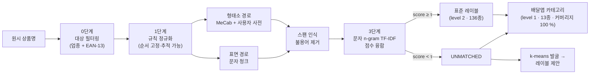
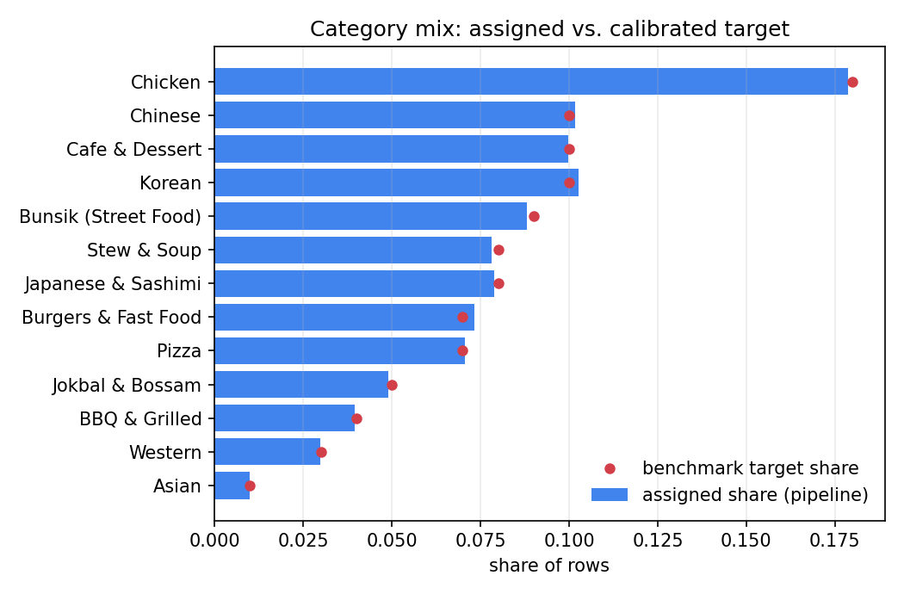
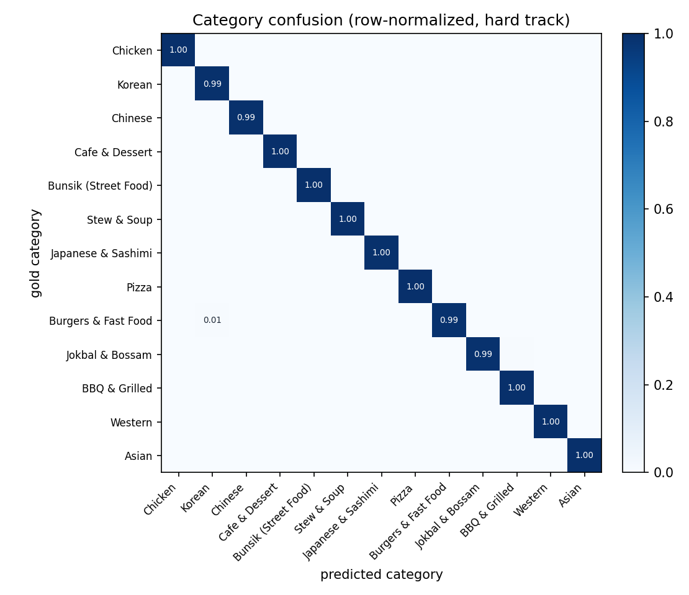
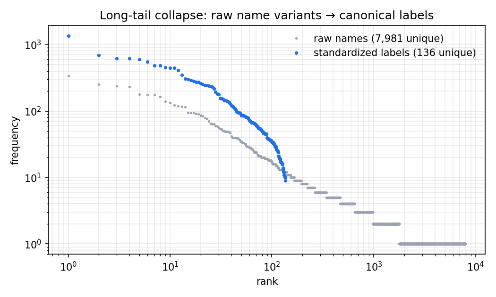
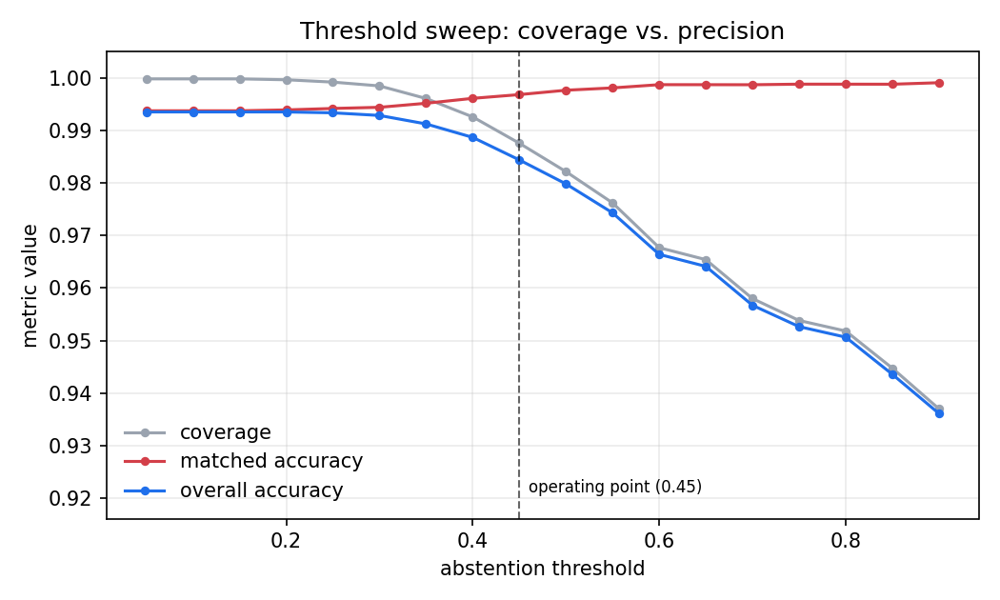

<div align="center">


# MenuNorm

**노이즈 상품명을 위한 한국어 2단계 표준화 파이프라인**

136개 표준 레이블 · 13개 배달앱 카테고리 · 카테고리 커버리지 100 % · 모든 수치가 시드로 재현

[](https://github.com/pmy02/Menunorm/actions)
[](pyproject.toml)
[](LICENSE)
[](paper/menunorm_ko.pdf)

[English](README.md) · **한국어**  |  [논문](paper/menunorm_ko.pdf) · [분류 체계 설계](docs/taxonomy.md) · [변경 이력](CHANGELOG.md)

</div>

---

```text
★양념 치킨 라지★         →  양념치킨       │ 치킨              1.00   완전일치
[강남점] ♥하와이안피자♥   →  하와이안피자    │ 피자              1.00   완전일치
불고고기 버거             →  불고기버거     │ 버거·패스트푸드    0.89   퍼지
♥부찌대개세트♥           →  UNMATCHED     │ 찜·탕·찌개        0.21   레이블 보류,
                                                                    카테고리는 유지
```

판매자가 입력한 상품명에는 장식 기호, 축약, 오타, 한·영 혼용이 뒤섞여
있습니다. **MenuNorm**은 이를 깨끗한 표준 레이블과 탐색용 카테고리로
해석하며, 드물게도 **추측하지 말아야 할 때를 압니다** — 세부 레이블은
보류할 수 있고, 카테고리는 언제나 배정됩니다.

**목차** ·
[핵심 특징](#핵심-특징) ·
[결과](#결과) ·
[빠른 시작](#빠른-시작) ·
[동작 방식](#동작-방식) ·
[분류 체계](#카테고리-분류-체계) ·
[벤치마크 설계](#벤치마크-설계) ·
[배경](#배경) ·
[설계 결정](#설계-결정) ·
[구조](#저장소-구조) ·
[재현성](#재현성) ·
[한계](#한계)

## 핵심 특징

|  | |
|---|---|
| **한 번의 실행, 두 개의 레벨** | 거부 옵션을 갖춘 세부 레이블(136종)과 결코 보류하지 않는 굵은 카테고리(13종). 어떤 행도 미분류로 남지 않고, 어떤 행도 억지로 레이블되지 않습니다. |
| **융합이 단일 토크나이저를 능가** | 형태소 경로(MeCab + 자동 컴파일 사용자 사전)와 표면 경로를 병렬 채점해 행 단위 최댓값을 채택합니다. 주장이 아니라 ablation으로 입증했습니다. |
| **NDA에도 불구하고 검증 가능** | 원 데이터는 비공개이므로, 아래 모든 수치를 명령 한 줄로 재생성되는 공개·결정적 벤치마크에서 측정했습니다. |
| **속이기 어렵게 설계** | 유일한 메타데이터 지름길에 의도적으로 노이즈를 심고, 폐쇄 세계 상한을 명시하며, *hard* 트랙은 어떤 렉시콘도 모르는 오타를 주입합니다. |

## 결과

모든 수치는 동봉된 벤치마크에서 측정했습니다. **20,000행, 시드 42**,
컴파일된 사용자 사전을 갖춘 MeCab, 임계값 τ = 0.45.

<details>
<summary><b>지표 정의</b> — 한 번 읽어 두면 이후 표가 명확해집니다</summary>

`ℓ̂`을 예측 레이블(`UNMATCHED` 가능), `ĉ`를 예측 카테고리라 하겠습니다.

| 지표 | 정의 | 의미 |
|---|---|---|
| **레이블 커버리지** | `P(ℓ̂ ≠ UNMATCHED)` | 매칭기가 세부 레이블을 확정한 비율 |
| **매칭 정확도** | `P(ℓ̂ = ℓ ∣ ℓ̂ ≠ UNMATCHED)` | *확정한 건에 대한* 정밀도 — 하위 시스템이 신뢰하는 값 |
| **전체 정확도** | `P(ℓ̂ = ℓ)` | 보류를 오답으로 계산한 엄격한 관점 |
| **카테고리 정확도** | `P(ĉ = c)` | level-1 정확도 |
| **카테고리 커버리지** | 카테고리가 배정된 행의 비율 | 설계상 1.0 — 테스트로 단언하고 매 실행 재측정 |
| **`category_accuracy_on_unmatched`** | `P(ĉ = c ∣ ℓ̂ = UNMATCHED)` | "찍어서 커버리지 채우기" 방지 — 세밀 판단이 거부한 곳에서 굵은 판단이 여전히 옳은가 |
| **필터 누수** | 0단계를 통과한 범위 밖 행 | 공산품·비외식 오염이 매칭기까지 도달한 양 |

</details>

#### 핵심 지표

| 트랙 | 레이블 커버리지 | 매칭 정확도 | 전체 정확도 | **카테고리 정확도** | **카테고리 커버리지** | 필터 누수 |
|---|---:|---:|---:|---:|---:|---:|
| standard | 100.0 % | 100.0 % | **100.0 %** | **100.0 %** | 100 % | 0 / 18,111 |
| **hard** | 98.75 % | 99.68 % | **98.44 %** | **99.72 %** | 100 % | 0 / 17,976 |

> **standard 트랙을 읽는 법.** 생성기와 렉시콘이 어휘를 공유하므로, 이
> 트랙의 만점은 파이프라인이 *알려진* 모든 노이즈 유형을 역변환한다는
> 사실만 증명하는 폐쇄 세계 회귀 테스트이지 실전 성능 주장이 아닙니다.
> **의미 있는 쪽은 hard 트랙**입니다 — 어떤 렉시콘도 커버하지 않는 글자
> 수준 오타(삭제·전치·중복)를 주입하므로 매칭기가 사전을 뒤져 찾을 수
> 없습니다.

롱테일 붕괴: hard 트랙 기준 **고유 원시 문자열 7,981개 → 레이블
136개**(standard는 6,912 → 136). 전체 실행 **약 1.5초**(단일 코어).

#### 분할 방식 ablation

융합은 공짜가 아닙니다 — 채점을 두 배로 합니다. 그 값은 합니다.

| 경로 | 커버리지 | 매칭 정확도 | 전체 정확도 | 융합 대비 |
|---|---:|---:|---:|---:|
| 형태소 단독 (MeCab + 사용자 사전) | 93.14 % | 99.30 % | 92.48 % | −5.96 pp |
| 표면 단독 | 98.58 % | 99.76 % | 98.34 % | −0.10 pp |
| **융합 (행 단위 최댓값)** | **98.75 %** | 99.68 % | **98.44 %** | — |

융합은 "표면 경로에 군더더기를 붙인 것"이 아닙니다. hard 트랙
**17,976행 중 702행**에서 형태소 경로가 승리 후보를 제공했는데, 모두 표면
n-gram이 낮게 채점하는 붙여 쓴 복합어를 MeCab 분할이 풀어낸
경우입니다([워크드 예제](#워크드-예제) 참고). 전체적으로 16,393행이
완전일치, 1,583행이 퍼지 TF-IDF로 해결되었습니다.

#### 레벨 간 우아한 성능 저하

레이블 매칭이 보류된 hard 트랙 **224행**에서도 카테고리는 **85.3 %**가
정답이었습니다.

| 원시 상품명 | 점수 | 레이블 | 카테고리 | 정답 카테고리 |
|---|---:|---|---|---|
| `♥부찌대개세트♥` | 0.21 | UNMATCHED | 찜·탕·찌개 | 찜·탕·찌개 ✅ |
| `마샹라궈 500ml` | 0.38 | UNMATCHED | 중식 | 중식 ✅ |
| `★떡 이볶★` | 0.37 | UNMATCHED | 분식 | 분식 ✅ |
| `겹삼살` | 0.44 | UNMATCHED | 고기·구이 | 고기·구이 ✅ |

`부찌대개세트`는 전치가 두 번 일어난 부대찌개 세트입니다. 확신 있는
레이블을 붙이기엔 너무 손상되었지만, 남은 문자 증거는 여전히 올바른
*진열대*를 가리킵니다. 이 값은 매 실행 `category_accuracy_on_unmatched`로
보고됩니다. 이 지표가 없으면 카테고리 커버리지 100 %는 반증 불가능한
숫자에 그칩니다.

특히 **17,976행 전부가 1차 분기로 해결**되었습니다
(`category_source = label`). 매장 업종·배치 최빈값 폴백은 이번
벤치마크에서 한 번도 발화하지 않았지만, 보장 장치로 남아 있습니다.

<details>
<summary><b>카테고리별 정밀도 / 재현율 / F1</b> (hard 트랙, 13개 전체)</summary>

| 카테고리 | 정밀도 | 재현율 | F1 | 지지도 |
|---|---:|---:|---:|---:|
| 치킨 | 0.9984 | 1.0000 | 0.9992 | 3,207 |
| 한식 | 0.9930 | 0.9946 | 0.9938 | 1,843 |
| 중식 | 1.0000 | 0.9946 | 0.9973 | 1,839 |
| 카페·디저트 | 0.9994 | 1.0000 | 0.9997 | 1,794 |
| 분식 | 0.9968 | 0.9994 | 0.9981 | 1,578 |
| 돈까스·회·일식 | 0.9958 | 0.9958 | 0.9958 | 1,418 |
| 찜·탕·찌개 | 0.9915 | 0.9986 | 0.9950 | 1,394 |
| 버거·패스트푸드 | 1.0000 | 0.9902 | 0.9951 | 1,332 |
| 피자 | 1.0000 | 1.0000 | 1.0000 | 1,268 |
| 족발·보쌈 | 1.0000 | 0.9921 | 0.9960 | 886 |
| 고기·구이 | 0.9888 | 0.9986 | 0.9936 | 705 |
| 양식 | 1.0000 | 1.0000 | 1.0000 | 535 |
| 아시안 | 1.0000 | 1.0000 | 1.0000 | 177 |

롱테일에서 무너지는 클래스가 없습니다. 아시안은 설계상 전체의 1 %인
177행뿐인데도 F1 1.000을 기록합니다. 매 실행 `category_report.csv`로
재생성됩니다.

</details>

<details>
<summary><b>임계값 스윕</b> — τ를 어떻게 고르고, 무엇을 지불하는가</summary>

τ는 커버리지와 정밀도를 잇는 단 하나의 다이얼입니다. 유사도 점수가
임계값과 무관하게 계산되므로, 파이프라인은 이 표(`threshold_sweep.csv`)를
추가 연산 없이 매 실행 재산출합니다.

| τ | 커버리지 | 매칭 정확도 | 전체 정확도 |
|---:|---:|---:|---:|
| 0.05 | 99.98 % | 99.37 % | 99.35 % |
| 0.25 | 99.92 % | 99.42 % | 99.33 % |
| 0.35 | 99.61 % | 99.51 % | 99.12 % |
| **0.45** | **98.75 %** | **99.68 %** | **98.44 %** |
| 0.55 | 97.62 % | 99.81 % | 97.43 % |
| 0.65 | 96.54 % | 99.87 % | 96.41 % |
| 0.85 | 94.48 % | 99.88 % | 94.36 % |

τ = 0.45는 매칭 정확도가 99.6 %를 넘으면서 커버리지가 98 % 이상을 유지하는
지점입니다. 자동 카탈로그에 투입한다면 τ를 높이고, 사람이 검수하는 큐에
넣는다면 낮추면 됩니다. 이 선택은 코드가 아니라
`configs/default.yaml`에 있습니다.

</details>

<details>
<summary><b>오류 분석</b> — 무엇이, 어떻게 실패하는가</summary>

hard 트랙 17,976행 중 281행이 레이블 레벨에서 틀렸고, **그중 224행(80 %)은
확신에 찬 오답이 아니라 보류로 안전하게 실패**했습니다.

| 원시 상품명 | 정제 결과 | 예측 | 정답 | 점수 |
|---|---|---|---|---:|
| `치김우동` | 김우동 | 우동 | 김치우동 | 0.58 |
| `발 주문폭주` | 발 | UNMATCHED | 족발 | 0.39 |
| `홍대 점 김치동우` | 홍대 점 김치동우 | UNMATCHED | 김치우동 | 0.38 |
| `마샹라궈 500ml` | 마샹라궈 | UNMATCHED | 마라샹궈 | 0.38 |

실패 유형은 두 갈래입니다.

1. **복합어를 더 짧은 유효 레이블로 줄여 버리는 삭제**(`치김우동` → 우동).
   0.58점의 *확신 있는* 오답이라 위험한 부류이며, 커버리지를 희생하지 않고
   임계값만으로는 잡을 수 없는 유일한 경우입니다.
2. **문자 n-gram을 흩뜨리는 전치**(`김치동우`, `마샹라궈`). τ 아래로
   떨어져 올바르게 보류됩니다.

잔여분은 발굴로도 이어집니다. 미매칭 이름을 군집화해 각 군집의 최빈
원소를 신규 레이블 후보로 제안하므로(`label_proposals.csv`, 이번 실행
14건), 체계적인 누락이 사라지지 않고 검수 항목으로 드러납니다.

</details>

## 빠른 시작

```bash
git clone https://github.com/pmy02/Menunorm.git
cd Menunorm
pip install -e ".[mecab,figures,dev]"

python scripts/generate_synthetic.py --n 20000 --seed 42   # 벤치마크 생성
python scripts/run_pipeline.py --config configs/default.yaml
```

`python-mecab-ko`는 Linux/macOS 휠을 제공합니다. 없는 환경에서는 표면
토크나이저로 자동 전환되어 그대로 동작하며, CI가 두 경로를 모두
검증합니다. 그때의 정확도 차이가 위 ablation의 수치입니다.

<details>
<summary><b>전체 사용법</b> — hard 트랙, 그림, 산출물, 라이브러리 API, 자체 데이터</summary>

```bash
# hard 트랙 (어떤 렉시콘도 커버하지 않는 오타 포함)
python scripts/generate_synthetic.py --n 20000 --seed 42 --hard \
    --out data/synthetic/menu_synthetic_hard.csv
python scripts/run_pipeline.py --config configs/default.yaml \
    --input data/synthetic/menu_synthetic_hard.csv --outdir results/hard

# 설정 파일을 건드리지 않고 운영점만 변경
python scripts/run_pipeline.py --config configs/default.yaml --threshold 0.55

# 완료된 실행 결과로부터 README 그림 재생성
python scripts/make_figures.py --results results/hard --out docs/figures
```

**산출물** — 매 실행이 완전한 감사 기록을 남깁니다.

| 파일 | 내용 |
|---|---|
| `standardized.csv` | 입력 행마다 `normalized`, `clean_name`, `pred_label`, `score`, `method`, `match_path`, `pred_category`, `category_source`, `rules_fired` |
| `metrics.json` | 두 레벨 지표, ablation 블록, 실행 시간, 환경 플래그 |
| `category_report.csv` | 카테고리별 정밀도 / 재현율 / F1 / 지지도 |
| `confusion_matrix.csv` | 행 정규화 카테고리 혼동 행렬 |
| `threshold_sweep.csv` | τ에 따른 커버리지·정밀도 곡선 |
| `label_proposals.csv` | 군집화된 보류 건 → 신규 레이블 후보 |
| `rule_trace_sample.csv` | 규칙 동작을 눈으로 확인하기 위한 200행 샘플 |

**설정**(`configs/default.yaml`) — 중요한 knob:

| 키 | 기본값 | 효과 |
|---|---|---|
| `match.threshold` | `0.45` | 보류 임계값 τ |
| `match.ngram_min/max` | `2` / `4` | TF-IDF 문자 n-gram 범위 |
| `tokenizer` | `auto` | `mecab`, `simple`, 또는 자동 감지 |
| `user_dictionary` | `true` | 토큰화 전 `user_dictionary_terms.txt` 컴파일 |
| `normalize.drop_residual_latin` | `true` | 용어집이 번역하지 못한 라틴 단어 제거 |
| `filter.nonfood_categories` | `[편의점, 마트]` | 0단계에서 제거할 매장 업종 |
| `discovery.max_clusters` | `15` | 제안할 신규 레이블 수 상한 |
| `columns.*` | — | 자체 CSV의 열 이름 매핑 |

**라이브러리로 사용:**

```python
from menunorm import Canonicalizer, RuleSet

rules   = RuleSet(translation_map={"americano": "아메리카노"})
matcher = Canonicalizer(["아메리카노", "카페라떼", "김치찌개"])

clean = rules.apply("★ICE Americano 세트★")   # → "아메리카노"
matcher.match([clean])                         # → 아메리카노, score 1.0

rules.apply_with_trace("★ICE Americano 세트★")
# → ("아메리카노", ["unicode", "translate", "decorations", "options", "cleanup"])
```

**자체 데이터 적용:** `input:`을 사용하는 CSV로 바꾸고 `columns:`를
매핑하면 됩니다. `gold:` / `gold_category:`는 정답이 있을 때만 지정하며,
없어도 파이프라인은 그대로 실행되고 평가 블록만 생략됩니다.

</details>

## 동작 방식



| 단계 | 동작 | 2023년 버전 대체 |
|---|---|---|
| **0 · 대상 필터링** | 비외식 매장과, 바코드가 EAN-13 체크디지트를 통과하는 행(메뉴가 아닌 포장 공산품)을 제거합니다. | 동일 아이디어, 이제 단위 테스트 |
| **1 · 규칙 정규화** | 7개의 순서 고정 규칙 — NFKC 정규화, 영→한 용어집, 괄호·장식 제거, 옵션·수량 패턴, 표기 변형, 잔여 정리 — 각 행이 발화한 규칙을 기록합니다. | 손으로 고치던 정규식, `ver26.xlsx → ver27.xlsx` |
| **2 · 이중 분할** | 도메인 사용자 사전을 컴파일한 MeCab과 의존성 없는 표면 분할. 불용어 제거는 **스팬 인식**으로 품사 필터보다 *먼저* 수행되어, 과분할된 형태(시그니처 → 시그/니/처)도 매칭됩니다. | Okt 명사 + 수작업 사전 시트 |
| **3 · 표준화 + 융합** | 두 후보를 채점 — 공백 제거 후 완전일치, 아니면 공백 유지형·접합형 모두에 대한 문자 2–4gram TF-IDF 코사인. 높은 쪽이 승리하고, τ 미만이면 **보류**합니다. | 변형 하나씩 수동 매핑 |
| **4 · 카테고리 배정** | 폴백 체인(최고 점수 레이블의 카테고리 → 매장 업종 → 배치 최빈값)과 발화 분기 기록. 커버리지 100 %는 설계상 보장되며 검증됩니다. | 존재하지 않던 단계 |
| **5 · 평가 + 발굴** | 두 레벨 지표, ablation, 혼동 행렬, 임계값 스윕. 보류 건은 군집화되어 신규 레이블 후보가 됩니다. | K-means는 EDA에서 1회 사용 |

**왜 융합인가?** 두 경로는 정반대로 무너집니다. 형태소 분석은 띄어쓰기
노이즈에서 글자를 잃고(`돼 지국밥` → 국밥; 쫄면은 용언으로 태깅되어 삭제),
표면 매칭은 붙여 쓴 복합어에 약합니다. 행 단위 최댓값은 살아남은 신호를
택합니다 — 전역 토크나이저 선택이라는 도박 대신, 행마다 데이터가 결정하는
방식입니다.

### 워크드 예제

`★치킨burger세트★ 1L` 한 행. 모든 단계가 `standardized.csv`에 남습니다.

| 단계 | 출력 | 설명 |
|---|---|---|
| **원시** | `★치킨burger세트★ 1L` | 장식 + 한·영 혼용 + 옵션 + 수량 |
| **1 · 규칙** | `치킨버거세트` | 발화: `unicode\|translate\|decorations\|options\|cleanup`. `burger`→`버거`는 용어집, `1L`은 수량으로 제거. 그러나 `세트`는 **살아남습니다** — 옵션 패턴이 문자열 끝에 앵커되는데 그 시점엔 `1L`이 뒤에 붙어 있었기 때문입니다 |
| **2a · 형태소** | `치킨` `버거` | MeCab이 `치킨버거세트` → 치킨 / 버거 / 세트로 분할, 스팬 인식 불용어 제거가 `세트`를 삭제 |
| **2b · 표면** | `치킨버거세트` | 분할이 없어 붙어 있는 `세트`가 그대로 남음 |
| **3 · 채점** | 형태소 `1.00`(완전일치) vs 표면 `0.82`(퍼지) | 융합이 형태소 경로를 채택 |
| **결과** | **치킨버거** │ **버거·패스트푸드** | `match_path=token`, `method=exact`, `category_source=label` |

이 한 행이 각 구성 요소의 존재 이유를 보여 줍니다. 규칙만으로는 `세트`가
남고, 표면 매칭만으로는 퍼지 0.82에 그치며, 형태소 경로와 스팬 인식 불용어
제거가 결합되어야 완전일치가 복원됩니다.

## 카테고리 분류 체계

13개 카테고리는 한국 배달앱의 탐색 구조를 따르되 **음식 종류 기준만**
사용합니다. 시간·기능 기반 분류(야식, 포장, 1인분)는 제외했습니다 —
요기요 파트너 문서 스스로가 야식을 음식이 아닌 *영업시간*으로 정의하므로,
상품명의 속성이 아니기 때문입니다. 앱은 한 매장을 최대 3개 카테고리에
노출하지만 분석에는 분할이 필요하므로 행마다 **정확히 하나**를 배정합니다.

> 치킨 · 한식 · 중식 · 카페·디저트 · 분식 · 찜·탕·찌개 · 돈까스·회·일식 ·
> 피자 · 버거·패스트푸드 · 족발·보쌈 · 고기·구이 · 양식 · 아시안

경계 판단은 암묵적으로 두지 않고 기록했습니다 — 회 관련 레이블은 플랫폼의
복합 명명을 따라 돈까스·회·일식으로, 마라탕은 중식으로, 샌드위치·베이글은
주된 판매 업태에 따라 카페·디저트로, 토스트·핫도그는 버거·패스트푸드로
배정했습니다. 설계 원칙과 출처, 전체 결정 로그는
**[`docs/taxonomy.md`](docs/taxonomy.md)**에 있습니다.

## 벤치마크 설계

NDA가 실데이터를 막으므로, 벤치마크는 스스로 신뢰를 얻어야 합니다. 세 가지
속성이 그 일을 합니다.

**1 · 노이즈 모델은 실제 코퍼스에서 도출**했습니다. 지어낸 것이
아닙니다. 표집된 표준명마다 독립적인 오염 연산이 적용됩니다.

| 연산 | 확률 | 예시 |
|---|---:|---|
| 장식·판촉 태그 | 0.25 | `★{}★`, `[인기] {}`, `{} 주문폭주` |
| 옵션·수량 접미 | 0.30 | `{} 세트`, `{}곱빼기`, `{} 1+1`, `{} (2인)` |
| 공백 삽입 | 0.20 | `돼 지국밥` |
| 표기 변형 | 0.20 | 돈가스 → 돈까스, 케이크 → 케익 |
| 한 → 영 치환 | 0.15 | 치즈 → `cheese`, 파스타 → `pasta` |
| 온도 접두(음료) | 0.25 | `ICE {}`, `핫 {}` |
| 지점 접두 | 0.10 | `[강남점] {}`, `홍대점 {}` |
| 단위 접미 | 0.08 | `{} 500ml`, `{} 1L` |
| **글자 오타(hard 트랙 전용)** | **0.12** | 삭제 / 전치 / 중복 — *어떤 렉시콘도 커버하지 않음* |

여기에 0단계 필터가 제거해야 할 오염이 더해집니다 — **유효한 EAN-13
체크디지트**를 지닌 공산품 6 %, 비외식 매장 행 4 %.

**2 · 클래스 비율은 균등이 아니라 보정**되어 있습니다. 카테고리는 공개
수요 통계에 근거한 `benchmark_share` 가중치로 뽑고(치킨 0.18로 1위, 아시안
0.01 꼬리), 카테고리 내부 레이블은 Zipf 분포(s = 1.05)를 따라 원 프로젝트의
동기가 된 롱테일을 재현합니다. 생성된 비율은 목표를 ±0.005 이내로
추적합니다.

**3 · 뻔한 지름길은 오염**시켰습니다. 확률 0.15로 행의
`store_category`가 실제 품목 카테고리와 다릅니다(돈가스를 파는 분식집).
따라서 매장 열을 복사하는 전략은 벌점을 받고, 파이프라인은 텍스트로 분류할
수밖에 없습니다. 이 열은 폴백 분기 (ii)에서만 쓰이며, 이번 벤치마크에서는
한 번도 발화하지 않았습니다.

## 배경

**산학협력.** 2023년 디지털 플랫폼 기업과의 협력에서 약 **2,000만 건의
원시 상품 데이터**를 약 **1,000개의 표준 레이블**로 정규화했습니다(표본
수기 검수 기준 약 95 %). 이 성과는 비공개 데이터에 대한 것으로 본
저장소에서 **재현되지 않으며**, 주장이 아니라 맥락으로 제공됩니다.

**왜 재구축했는가.** 협력 이후 두 문제가 남았습니다. 워크플로가
방법론적으로 취약했습니다 — 규칙을 노트북 안에서 정규식 한 줄씩 손으로
고치고, 진행 상황은 스프레드시트를 `ver26.xlsx → ver27.xlsx`로 저장하며
관리했습니다. 테스트도, 추적 기록도, 특정 이름이 왜 그 레이블이 되었는지
설명할 방법도 없었습니다. 그리고 데이터가 NDA에 묶여 무엇도 외부에서
검증할 수 없었습니다. MenuNorm은 두 문제를 함께 해결합니다 — 방법은 설정
기반·테스트 완비·감사 가능한 패키지가 되었고, 평가는 모든 수치가
측정·재생성되는 공개 벤치마크로 옮겨졌습니다.

2023년 원본 노트북은 [`notebooks/legacy/`](notebooks/legacy)에
보존했습니다(코드 원본 유지, 주석만 영문화). 출발점을 계속 들여다볼 수
있도록 하기 위해서입니다.

## 설계 결정

<details>
<summary><b>왜 보류를 허용하나요? 레이블 커버리지 100 %가 더 좋아 보이지 않나요?</b></summary>

보기엔 낫고 실제로는 나쁩니다. 카탈로그 표준화에서 확신에 찬 오답은
검색과 분석으로 조용히 전파되지만, 보류는 눈에 보이고 라우팅할 수 있는
사건입니다. 오류 분석이 그 대가를 보여 줍니다 — 잔여 레이블 오류의 80 %가
확신 있는 오답이 아니라 `UNMATCHED`로 드러나고, 그중 85 %는 여전히 올바른
카테고리를 지니므로 하위 시스템은 행이 아니라 정밀도만 잃습니다.

</details>

<details>
<summary><b>왜 임베딩이나 신경망 분류기가 아니라 문자 n-gram TF-IDF인가요?</b></summary>

무게 순으로 세 가지입니다. **(1) 학습 말뭉치가 없습니다** — NDA 경계의
공개 측에는 존재하지 않으므로, 지도 학습 분류기는 평가에 쓰는 합성
데이터로 학습해야 하고 그것은 아무것도 증명하지 못합니다. **(2) 지배적인
노이즈가 의미가 아니라 표기**입니다 — 띄어쓰기, 붙은 옵션, 오타. 문자
n-gram이 정확히 그에 맞는 귀납 편향입니다. **(3) 검사 가능성** — 모든
결정이 명명된 레이블에 대한 점수로 환원되고, 20,000행 벤치마크 전체가 GPU
없이 단일 코어에서 약 1.5초에 돕니다. 한국어 SBERT 후보는 동일 ablation
프로토콜로 평가되는 *세 번째 융합 경로*로 로드맵에 있습니다. 도움이 되는지
정직하게 알아내는 방법이 그것이기 때문입니다.

</details>

<details>
<summary><b>실제 앱은 최대 3개를 허용하는데 왜 행당 하나인가요?</b></summary>

멀티 태깅은 탐색을 위한 것이고, 분석에는 분할이 필요합니다. 겹치는
카테고리 위에서 매출을 합하면 이중 계산이 되고, 멀티 레이블 혼동 행렬은
해석되지 않습니다. 플랫폼 동작과의 이 차이는 감추지 않고 의도적으로
문서화했습니다 — [`docs/taxonomy.md`](docs/taxonomy.md) 참고.

</details>

<details>
<summary><b>standard 트랙이 100 %를 찍어도 괜찮은가요?</b></summary>

그것은 결과가 아니라 회귀 테스트이기 때문입니다. 변경이 알려진 노이즈
유형을 깨뜨렸을 때 요란하게 실패하는 것이 그 역할입니다. hard 트랙만
보고하면 이 보장이 감춰지고, standard 트랙만 보고하면 오해를 부릅니다.
그래서 둘 다 싣고, 상한의 이유를 같은 자리에서 설명합니다.

</details>

<details>
<summary><b>레거시 노트북을 왜 저장소에 남겨 두나요?</b></summary>

출처 때문입니다. "수작업 정규식 편집을 대체했다"는 주장은 그 수작업
버전이 보일 때에만 검증됩니다. `notebooks/legacy/` 아래에 명확히
격리해 두고 변경 이력에서 참조합니다.

</details>

## 그림

<p align="center">
  <br>
  <em>배정된 카테고리 비율이 보정 목표를 그대로 추적합니다(최대 편차 0.005).</em>
</p>

<p align="center">
  <br>
  <em>hard 트랙에서도 혼동 행렬은 대각선에 가깝습니다. 대각 외 최대 셀이 0.008을 넘지 않고, 큰 값들은 족발·보쌈 → 고기·구이처럼 의미적으로 인접한 경계에 놓입니다.</em>
</p>

<p align="center">
  <br>
  <em>7,981개의 원시 변형이 136개 표준 레이블로 수렴합니다 — 표준화의 핵심 가치를 한 장으로.</em>
</p>

<p align="center">
  <br>
  <em>τ가 커지면 커버리지는 내려가고 정밀도는 올라갑니다. 운영점은 하드코딩이 아니라 이 곡선에서 선택됩니다.</em>
</p>

## 저장소 구조

```
src/menunorm/
├── rules.py          1단계 — 7개 순서 고정 규칙 + 행별 추적
├── tokenize.py       2단계 — MeCab / 표면, 스팬 인식 불용어
├── dictionary.py     사용자 사전 빌더 (유니코드 종성 산술)
├── canonicalize.py   3단계 — 완전일치 + 문자 n-gram TF-IDF + 보류
├── taxonomy.py       4단계 — 13개 카테고리 레이어, 전체 커버리지 폴백
├── cluster.py        5단계 — k-means 레이블 발굴
├── evaluate.py       지표 정의 + 임계값 스윕
├── synthetic.py      벤치마크 생성기 (비율 보정, 2트랙)
├── barcode.py        EAN-13 검증 (0단계)
└── pipeline.py       오케스트레이션 + 산출물 기록

configs/default.yaml  모든 설정을 한 곳에
data/lexicon/         레이블, 카테고리, 불용어, 변형·번역 맵
data/sample/          벤치마크 200행 샘플 (커밋됨)
docs/taxonomy.md      카테고리 설계: 원칙, 출처, 결정 로그
docs/brand/           로고(SVG), 아이콘, 소셜 프리뷰
paper/                워킹 페이퍼 — 국문/영문, LaTeX + Word, 그림 포함
scripts/              generate_synthetic · run_pipeline · make_figures
tests/                엔드투엔드 회귀 포함 35개 테스트
notebooks/legacy/     2023년 원본 노트북 (출처 보존)
```

## 재현성

```bash
pip install -e ".[mecab,figures,dev]" && pytest -q
python scripts/generate_synthetic.py --n 20000 --seed 42
python scripts/run_pipeline.py --config configs/default.yaml
```

시드가 같으면 생성·매칭·군집화·지표 모두 결정적입니다. Python 3.12 /
pandas 3.0.2 / scikit-learn 1.8.0에서 검증했습니다.

**CI**는 푸시마다 ruff 린트, 35개 테스트, 1,000행 엔드투엔드 스모크 실행을
Python 3.10·3.12와 **두 토크나이저 백엔드** 모두에서 수행합니다. MeCab
없는 폴백 경로가 조용히 썩는 일을 막기 위해서입니다. 테스트는 실행 여부가
아니라 동작을 단언합니다 — 바코드 체크디지트, 실제 MeCab 태그 열에 대한
스팬 인식 불용어 제거, 사전 밖 입력에 대한 보류, 카테고리 커버리지 100 %,
새로 생성한 800행 샘플에 대한 정확도 하한.

## 버전 이력

| 버전 | 핵심 |
|---|---|
| **v3.0.0** | 2단계 표준화 — 커버리지가 보장된 13개 카테고리 레이어, 카테고리 평가, 비율 보정·지름길 차단 벤치마크 |
| **v2.0.0** | `menunorm` 패키지로 재구축 — 규칙 엔진, 이중 분할 융합, 공개 합성 벤치마크, 보류, 테스트 + CI |
| **v1.0.0** | 2023년 산학협력 원본 (노트북, NDA 데이터) |

상세 내역은 [`CHANGELOG.md`](CHANGELOG.md)에 있습니다.

## 한계

- **벤치마크는 합성 데이터입니다.** 노이즈 모델이 기록된 실제 유형에서
  도출되었고 hard 트랙이 렉시콘 커버리지라는 교란 요인을 제거하지만,
  절대 수치는 개방 세계 운영 데이터(미지의 오타 부류, OCR 노이즈, 신규
  메뉴)보다 낙관적입니다.
- **`benchmark_share`는 설계 선택**입니다. 이질적 공개 통계를 참고했을 뿐
  시장 측정치가 아닙니다 — [`docs/taxonomy.md`](docs/taxonomy.md)의 정직성
  노트를 참고하세요.
- **한·영 혼용은 오프라인 용어집에 의존**합니다. 용어집에 없는 로마자
  표기(`kimchi jjigae`)는 추측되지 않고 `UNMATCHED`로 보류됩니다(카테고리는
  배정됨).
- **확신 있는 오답 부류는 해결되지 않았습니다.** 복합어를 더 짧은 유효
  레이블로 줄이는 삭제(`치김우동` → 우동)는 τ를 넘기므로 임계값만으로는
  잡을 수 없습니다.
- **인벤토리가 작습니다.** 136개 레이블은 의도적인 범위 선택이며, 1,000개
  이상이 되면 근사 최근접 탐색이 필요합니다.

## 로드맵

- [ ] ANN(FAISS) 매칭으로 표준 레이블 1,000개 이상 확장
- [ ] 한국어 SBERT 임베딩 매처를 세 번째 융합 후보로 추가, 동일 ablation 프로토콜 적용
- [ ] 마진 기반 액티브 러닝: 저마진 매칭을 카테고리 인지형 검수 큐로 라우팅
- [ ] 자모 단위 n-gram으로 삭제·전치 실패 부류 공략
- [ ] 레이블 인벤토리 확장 시 도시락·죽 카테고리 추가

## 인용

```bibtex
@software{park2023menunorm,
  author = {Park, Minyoung},
  title  = {MenuNorm: Two-Level Standardization of Noisy Korean Product Names},
  year   = {2023},
  url    = {https://github.com/pmy02/Menunorm}
}
```

## 라이선스

MIT — [LICENSE](LICENSE) 참고. 관리:
[@pmy02](https://github.com/pmy02). 이슈와 PR을 환영합니다.
