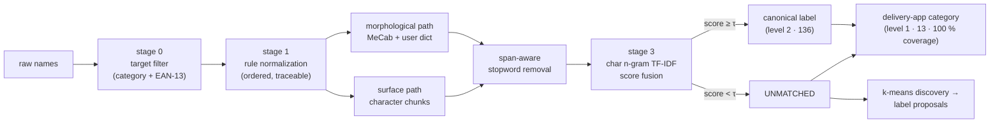

<div align="center">


# MenuNorm

**Two-level standardization of noisy Korean product names**

136 canonical labels · 13 delivery-app categories · 100 % category coverage · reproducible from a seed

[](https://github.com/pmy02/Menunorm/actions)
[](pyproject.toml)
[](LICENSE)
[](paper/menunorm.pdf)

**English** · [한국어](README.ko.md)  |  [Paper](paper/menunorm.pdf) · [Taxonomy design](docs/taxonomy.md) · [Changelog](CHANGELOG.md)

</div>

---

```text
★양념 치킨 라지★         →  양념치킨       │ 치킨              1.00
[강남점] ♥하와이안피자♥   →  하와이안피자    │ 피자              1.00
불고고기 버거             →  불고기버거     │ 버거·패스트푸드    0.89   fuzzy match
♥부찌대개세트♥           →  UNMATCHED     │ 찜·탕·찌개        0.21   label abstains,
                                                                    category still holds
```

Merchant-typed product names arrive decorated, abbreviated, misspelled, and
code-switched. **MenuNorm** maps them to a clean canonical label *and* a
browsable category — and, crucially, knows when **not** to guess: the fine
label may abstain, while the category is always assigned.

## Highlights

- **Two levels, one pass.** A fine label with a reject option (136 classes) plus a coarse category that never abstains (13 classes) — so no row is ever left unclassified.
- **Fusion beats either tokenizer.** Morphological (MeCab + auto-compiled user dictionary) and surface segmentations are scored in parallel; the per-row max wins. Proven by ablation, not asserted.
- **Verifiable despite an NDA.** The source data is confidential, so every number here is measured on an open, deterministic benchmark that anyone can regenerate in one command.
- **Engineered to be hard to game.** A shortcut column is deliberately poisoned, the closed-world ceiling is stated openly, and a *hard* track injects typos no lexicon covers.

## Key results

Measured on the open benchmark (20,000 rows, seed 42). The **hard track** is
the meaningful one — it adds character-level typos that no lexicon covers.

| Track | Label accuracy | Label coverage | **Category accuracy** | **Category coverage** | Filter leakage |
|---|---:|---:|---:|---:|---:|
| standard | 100.0 % | 100.0 % | **100.0 %** | **100 %** | 0 rows |
| hard | 98.44 % | 98.75 % | **99.72 %** | **100 %** | 0 rows |

> **How to read the standard track.** The generator and the lexicons share a
> vocabulary, so a perfect score there certifies that the pipeline inverts
> every *known* noise mode — a closed-world regression test, not a real-world
> claim. The hard track exists precisely to remove that confound.

**Graceful degradation across levels.** On the 224 hard-track rows where the
label matcher abstained, the category was still correct **85.3 %** of the
time. `♥부찌대개세트♥` scores 0.21 against its best label and is rightly
refused — yet resolves to 찜·탕·찌개. Reported every run as
`category_accuracy_on_unmatched`.

**Segmentation ablation** (hard track) — fusion dominates both single paths:

| Path | Coverage | Matched acc. | Overall acc. |
|---|---:|---:|---:|
| Morphological only (MeCab + user dict) | 93.14 % | 99.30 % | 92.48 % |
| Surface only | 98.58 % | 99.76 % | 98.34 % |
| **Fused (per-row max)** | **98.75 %** | 99.68 % | **98.44 %** |

A full 20k-row run finishes in **≈ 1 second** on a single core.

## Quick start

```bash
git clone https://github.com/pmy02/Menunorm.git
cd Menunorm
pip install -e ".[mecab,figures,dev]"

python scripts/generate_synthetic.py --n 20000 --seed 42   # build the benchmark
python scripts/run_pipeline.py --config configs/default.yaml
```

`python-mecab-ko` ships Linux/macOS wheels; without it the pipeline falls
back to the surface tokenizer and stays fully runnable. CI covers both paths.

<details>
<summary><b>Full usage — hard track, figures, library API, your own data</b></summary>

```bash
# hard track (typos uncovered by any lexicon)
python scripts/generate_synthetic.py --n 20000 --seed 42 --hard \
    --out data/synthetic/menu_synthetic_hard.csv
python scripts/run_pipeline.py --config configs/default.yaml \
    --input data/synthetic/menu_synthetic_hard.csv --outdir results/hard

# regenerate the README figures from a finished run
python scripts/make_figures.py --results results/hard --out docs/figures
```

Each run writes to its output directory:

| Artifact | Contents |
|---|---|
| `standardized.csv` | Per row: score, match path, category + `category_source`, `rules_fired` audit trace |
| `metrics.json` | Both levels, ablation, runtime |
| `category_report.csv` | Per-category precision / recall / F1 |
| `confusion_matrix.csv` | Row-normalized category confusion |
| `threshold_sweep.csv` | Coverage/precision curve across τ |
| `label_proposals.csv` | Clustered abstentions → new-label candidates for review |

As a library:

```python
from menunorm import Canonicalizer, RuleSet

rules   = RuleSet(translation_map={"americano": "아메리카노"})
matcher = Canonicalizer(["아메리카노", "카페라떼", "김치찌개"])

clean = rules.apply("★ICE Americano 세트★")   # → "아메리카노"
matcher.match([clean])                         # → 아메리카노, score 1.0
```

For your own data, point `configs/default.yaml` at your CSV and map the
column names under `columns:` (set `gold:` / `gold_category:` only if you
have ground truth).

</details>

## Background

**The engagement.** In a 2023 collaboration with a digital-platform company,
roughly **20M raw product records** were standardized into about **1,000
canonical labels** (~95 % on a hand-audited sample). That outcome describes
proprietary data and is *not* reproducible from this repository — it is
context, not a claim.

**Why the rebuild.** Two problems outlived the engagement. The workflow was
methodologically fragile: rules were hand-edited inside notebooks, one regex
at a time, with progress tracked by re-saving a spreadsheet as
`ver26.xlsx → ver27.xlsx`. And the data was under NDA, so nothing was
externally verifiable. MenuNorm fixes both — the method became a
configuration-driven, tested, auditable package, and evaluation moved to an
open benchmark where every reported number is measured and reproducible.

The original 2023 notebooks are preserved under
[`notebooks/legacy/`](notebooks/legacy) (code untouched, comments
translated) for provenance.

## How it works



| Stage | What it does | Replaced from 2023 |
|---|---|---|
| **0 · Target filter** | Drops non-food stores and rows with a *valid* EAN-13 check digit (packaged retail goods). | Same idea, now unit-tested |
| **1 · Rule normalization** | Ordered declarative rules — glossary translation, bracket/decoration removal, option patterns, spelling variants — with a per-row `rules_fired` trace. | Hand-edited regexes, spreadsheet versioning |
| **2 · Dual segmentation** | MeCab with a compiled domain user dictionary *and* a dependency-free surface pass. Stopwords are removed **span-aware**, so over-segmented forms (시그니처 → 시그/니/처) still match. | Okt nouns + manual dictionary sheet |
| **3 · Canonicalization + fusion** | Both candidates scored (exact, then char 2–4-gram TF-IDF cosine); higher score wins; below τ the matcher **abstains** rather than forcing a label. | One-by-one manual mapping |
| **4 · Category assignment** | Fallback chain — argmax label's category → store prior → batch prior — with the branch recorded per row. Coverage is 100 % by construction *and* measured. | Did not exist |
| **5 · Evaluation + discovery** | Metrics at both levels, ablation, confusion matrix, threshold sweep; abstentions are clustered into new-label proposals for human review. | K-means used once as EDA |

**Why fuse?** The two paths are brittle in opposite ways. Morphological
analysis loses characters under spacing noise (`돼 지국밥` → 국밥; 쫄면
tagged as a verb form and dropped), while surface matching is weaker on glued
compounds. Taking the per-row maximum keeps whichever signal is stronger —
and the ablation above quantifies the gain instead of assuming it.

## Category taxonomy

The 13 categories mirror the browsing rail of Korean delivery apps and are
**food-type only**: platform categories that are time- or function-based
(야식, 포장, 1인분) are excluded — Yogiyo's own partner documentation defines
야식 by store operating hours, not by food. Apps let one store appear in up
to three categories; analytics needs a partition, so MenuNorm assigns
**exactly one** per row. The benchmark's class mix is calibrated to published
demand statistics (chicken first at ≈ 0.18, a thin Asian tail at ≈ 0.01).

> 치킨 · 한식 · 중식 · 카페·디저트 · 분식 · 찜·탕·찌개 · 돈까스·회·일식 ·
> 피자 · 버거·패스트푸드 · 족발·보쌈 · 고기·구이 · 양식 · 아시안

Design principles, source citations, and the full decision log — why 회 sits
with 일식, why 마라탕 is 중식, why 야식 is out — are in
**[`docs/taxonomy.md`](docs/taxonomy.md)**.

## Figures

<p align="center">
  <br>
  <em>Assigned category mix tracks the calibrated target (max deviation 0.005).</em>
</p>

<p align="center">
  <br>
  <em>Category confusion stays near-diagonal on the hard track.</em>
</p>

<p align="center">
  <br>
  <em>7,981 raw variants collapse onto 136 canonical labels.</em>
</p>

<p align="center">
  <br>
  <em>The abstention threshold is a dial between coverage and precision; τ = 0.45 is chosen from this sweep, re-emitted on every run.</em>
</p>

## Repository layout

```
src/menunorm/
├── rules.py          stage 1 — declarative, traceable normalization
├── tokenize.py       stage 2 — MeCab / surface + span-aware stopwords
├── dictionary.py     MeCab user-dictionary builder (unicode jongseong)
├── canonicalize.py   stage 3 — exact + char n-gram TF-IDF + abstention
├── taxonomy.py       stage 4 — 13-category layer, full-coverage fallback
├── cluster.py        stage 5 — k-means label discovery
├── evaluate.py       metrics + threshold sweep
├── synthetic.py      benchmark generator (share-calibrated, 2 tracks)
├── barcode.py        EAN-13 validation (stage 0)
└── pipeline.py       orchestration + artifacts

configs/default.yaml  every knob in one place
data/lexicon/         labels, categories, stopwords, variant & translation maps
data/sample/          200-row committed sample of the benchmark
docs/taxonomy.md      category design: principles, sources, decision log
paper/                working paper (EN/KO · LaTeX + Word) and its figures
scripts/              generate_synthetic · run_pipeline · make_figures
tests/                35 tests incl. end-to-end pipeline regression
notebooks/legacy/     original 2023 notebooks (provenance)
```

## Reproducibility

```bash
pip install -e ".[mecab,figures,dev]" && pytest -q
python scripts/generate_synthetic.py --n 20000 --seed 42
python scripts/run_pipeline.py --config configs/default.yaml
```

Deterministic given the seed. Verified on Python 3.12 / pandas 3.0.2 /
scikit-learn 1.8.0. CI exercises Python 3.10 and 3.12, both tokenizer
backends, lint, the unit suite, and a 1k-row end-to-end smoke run.

## Version history

| Version | Focus |
|---|---|
| **v3.0.0** | Two-level standardization — 13-category layer with guaranteed coverage, category evaluation, share-calibrated and shortcut-proofed benchmark |
| **v2.0.0** | Rebuild as the `menunorm` package — rule engine, dual-segmentation fusion, open synthetic benchmark, abstention, tests + CI |
| **v1.0.0** | Original 2023 industry collaboration (notebooks, NDA data) |

Details in [`CHANGELOG.md`](CHANGELOG.md).

## Limitations

- The benchmark is synthetic. Its noise model is drawn from documented
  real-world modes and the hard track removes lexicon coverage as a
  confound, but absolute numbers stay optimistic relative to open-world
  production data (unknown typo classes, OCR noise, emerging menu items).
- `benchmark_share` is a design choice informed by heterogeneous published
  statistics — **not** a market measurement. See the note in
  [`docs/taxonomy.md`](docs/taxonomy.md).
- Code-switching recovery depends on an offline glossary; unseen
  romanizations correctly fall through to `UNMATCHED` rather than being
  guessed (their category is still assigned).
- The canonical inventory (136 labels) is deliberately small; scaling to
  1,000+ labels with ANN search is on the roadmap.

## Roadmap

- [ ] Scale to 1,000+ canonical labels with ANN (FAISS) matching
- [ ] Korean SBERT embedding matcher as a third fusion candidate, same ablation protocol
- [ ] Active-learning loop routing low-margin matches into a category-aware review queue
- [ ] Jamo-level n-grams for stronger typo robustness on the hard track
- [ ] 도시락·죽 category once the label inventory covers it

## Citation

```bibtex
@software{park2023menunorm,
  author = {Park, Minyoung},
  title  = {MenuNorm: Two-Level Standardization of Noisy Korean Product Names},
  year   = {2023},
  url    = {https://github.com/pmy02/Menunorm}
}
```

## License

MIT — see [LICENSE](LICENSE). Maintained by
[@pmy02](https://github.com/pmy02); issues and pull requests welcome.
