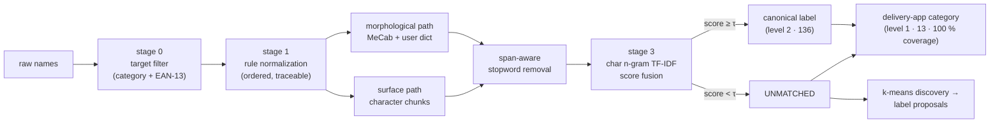
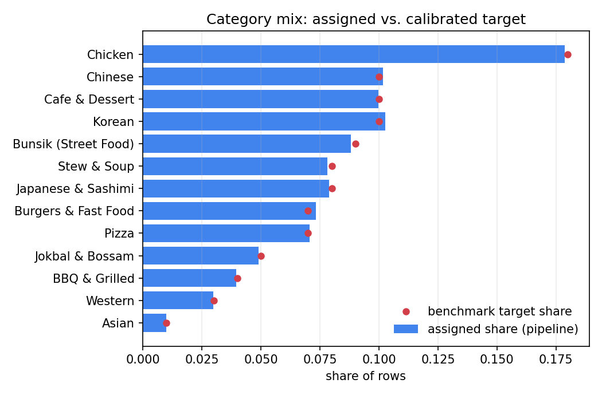
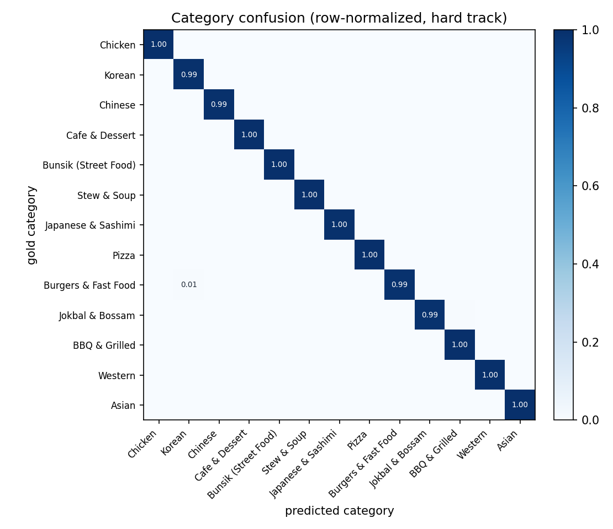
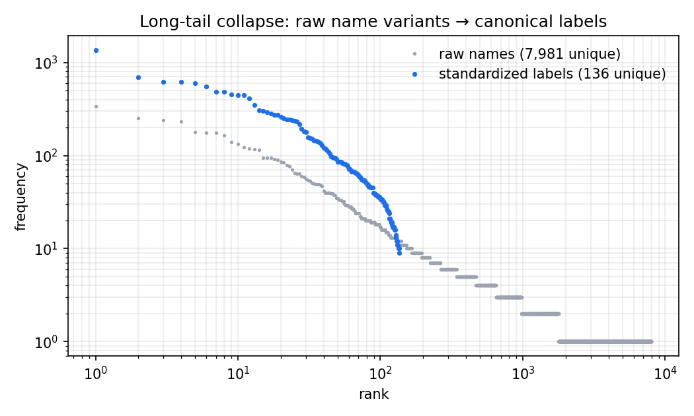
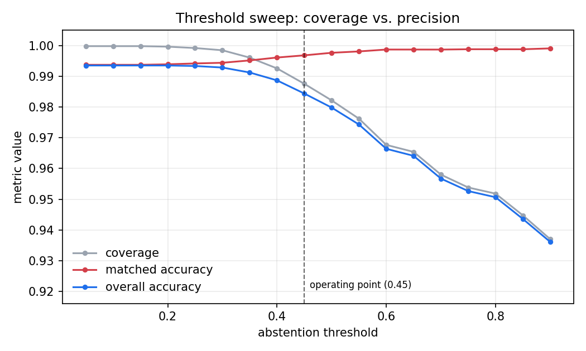

<div align="center">


# MenuNorm

**Two-level standardization of noisy Korean product names**

136 canonical labels · 13 delivery-app categories · 100 % category coverage · every number reproducible from a seed

[](https://github.com/pmy02/Menunorm/actions)
[](pyproject.toml)
[](LICENSE)
[](paper/menunorm.pdf)

**English** · [한국어](README.ko.md)  |  [Paper](paper/menunorm.pdf) · [Taxonomy design](docs/taxonomy.md) · [Changelog](CHANGELOG.md)

</div>

---

```text
★양념 치킨 라지★         →  양념치킨       │ 치킨              1.00   exact
[강남점] ♥하와이안피자♥   →  하와이안피자    │ 피자              1.00   exact
불고고기 버거             →  불고기버거     │ 버거·패스트푸드    0.89   fuzzy
♥부찌대개세트♥           →  UNMATCHED     │ 찜·탕·찌개        0.21   label abstains,
                                                                    category still holds
```

Product names typed by merchants arrive decorated, abbreviated, misspelled,
and code-switched. **MenuNorm** resolves them to a clean canonical label
*and* a browsable category — and, unusually, knows when **not** to guess: the
fine-grained label may abstain, while the category is always assigned.

**Contents** ·
[Highlights](#highlights) ·
[Results](#results) ·
[Quick start](#quick-start) ·
[How it works](#how-it-works) ·
[Taxonomy](#category-taxonomy) ·
[Benchmark](#benchmark-design) ·
[Background](#background) ·
[Design decisions](#design-decisions) ·
[Layout](#repository-layout) ·
[Reproducibility](#reproducibility) ·
[Limitations](#limitations)

## Highlights

|  | |
|---|---|
| **Two levels, one pass** | A fine label with a reject option (136 classes) *plus* a coarse category that never abstains (13 classes). No row is left unclassified, and no row is force-labelled. |
| **Fusion beats either tokenizer** | Morphological (MeCab + auto-compiled user dictionary) and surface segmentations are scored in parallel; the per-row maximum wins. Demonstrated by ablation, not asserted. |
| **Verifiable despite an NDA** | The source data is confidential, so every number below is measured on an open, deterministic benchmark that regenerates in one command. |
| **Built to resist gaming** | The one metadata shortcut is deliberately poisoned, the closed-world ceiling is stated openly, and a *hard* track injects typos no lexicon covers. |

## Results

All figures come from the shipped benchmark: **20,000 rows, seed 42**, MeCab
with the compiled user dictionary, threshold τ = 0.45.

<details>
<summary><b>Metric definitions</b> — read once, the tables become unambiguous</summary>

Let `ℓ̂` be the predicted label (possibly `UNMATCHED`) and `ĉ` the predicted category.

| Metric | Definition | Why it matters |
|---|---|---|
| **Label coverage** | `P(ℓ̂ ≠ UNMATCHED)` | How often the matcher commits to a fine label |
| **Matched accuracy** | `P(ℓ̂ = ℓ ∣ ℓ̂ ≠ UNMATCHED)` | Precision *of the commitments* — the number a downstream consumer trusts |
| **Overall accuracy** | `P(ℓ̂ = ℓ)` | Abstentions counted as errors; the strict view |
| **Category accuracy** | `P(ĉ = c)` | Level-1 correctness |
| **Category coverage** | share of rows assigned a category | 1.0 by construction — asserted in tests, re-measured every run |
| **`category_accuracy_on_unmatched`** | `P(ĉ = c ∣ ℓ̂ = UNMATCHED)` | Guards against "coverage by guessing": is the coarse call still right where the fine one refused? |
| **Filter leakage** | out-of-scope rows surviving stage 0 | Retail/non-food contamination reaching the matcher |

</details>

#### Headline

| Track | Label coverage | Matched acc. | Overall acc. | **Category acc.** | **Category coverage** | Filter leakage |
|---|---:|---:|---:|---:|---:|---:|
| standard | 100.0 % | 100.0 % | **100.0 %** | **100.0 %** | 100 % | 0 / 18,111 |
| **hard** | 98.75 % | 99.68 % | **98.44 %** | **99.72 %** | 100 % | 0 / 17,976 |

> **How to read the standard track.** The generator and the lexicons share a
> vocabulary, so a perfect score there certifies only that the pipeline
> inverts every *known* noise mode — a closed-world regression test, not a
> real-world claim. The **hard track is the meaningful one**: it adds
> character-level typos (deletion, transposition, duplication) that no
> lexicon covers, so the matcher cannot look them up.

Long-tail collapse: **7,981 unique raw strings → 136 labels** on the hard
track (6,912 → 136 on standard). Full run: **≈ 1.5 s** on a single core.

#### Segmentation ablation

Fusion is not free — it doubles the scoring work. It earns that cost:

| Path | Coverage | Matched acc. | Overall acc. | Δ vs. fused |
|---|---:|---:|---:|---:|
| Morphological only (MeCab + user dict) | 93.14 % | 99.30 % | 92.48 % | −5.96 pp |
| Surface only | 98.58 % | 99.76 % | 98.34 % | −0.10 pp |
| **Fused (per-row max)** | **98.75 %** | 99.68 % | **98.44 %** | — |

Fusion is not "surface with extra steps": the morphological path supplies the
winning candidate on **702 of 17,976** hard-track rows, precisely where
MeCab's segmentation resolves a glued compound that surface n-grams score
lower (see the [worked example](#worked-example)). Overall, 16,393 rows
resolve by exact match and 1,583 by fuzzy TF-IDF.

#### Graceful degradation across levels

On the **224** hard-track rows where the label matcher abstained, the
category was still correct **85.3 %** of the time.

| Raw name | Score | Label | Category | Gold category |
|---|---:|---|---|---|
| `♥부찌대개세트♥` | 0.21 | UNMATCHED | 찜·탕·찌개 | 찜·탕·찌개 ✅ |
| `마샹라궈 500ml` | 0.38 | UNMATCHED | 중식 | 중식 ✅ |
| `★떡 이볶★` | 0.37 | UNMATCHED | 분식 | 분식 ✅ |
| `겹삼살` | 0.44 | UNMATCHED | 고기·구이 | 고기·구이 ✅ |

`부찌대개세트` is 부대찌개 세트 with two transpositions — far too corrupted
for a confident label, yet the residual character evidence still points at
the right *shelf*. This is reported every run as
`category_accuracy_on_unmatched`; without it, 100 % category coverage would
be unfalsifiable.

Notably, **all 17,976 categories were resolved by the primary branch**
(`category_source = label`) — the store-prior and batch-prior fallbacks never
had to fire on this benchmark, though they remain as guarantees.

<details>
<summary><b>Per-category precision / recall / F1</b> (hard track, all 13 classes)</summary>

| Category | Precision | Recall | F1 | Support |
|---|---:|---:|---:|---:|
| 치킨 | 0.9984 | 1.0000 | 0.9992 | 3,207 |
| 한식 | 0.9930 | 0.9946 | 0.9938 | 1,843 |
| 중식 | 1.0000 | 0.9946 | 0.9973 | 1,839 |
| 카페·디저트 | 0.9994 | 1.0000 | 0.9997 | 1,794 |
| 분식 | 0.9968 | 0.9994 | 0.9981 | 1,578 |
| 돈까스·회·일식 | 0.9958 | 0.9958 | 0.9958 | 1,418 |
| 찜·탕·찌개 | 0.9915 | 0.9986 | 0.9950 | 1,394 |
| 버거·패스트푸드 | 1.0000 | 0.9902 | 0.9951 | 1,332 |
| 피자 | 1.0000 | 1.0000 | 1.0000 | 1,268 |
| 족발·보쌈 | 1.0000 | 0.9921 | 0.9960 | 886 |
| 고기·구이 | 0.9888 | 0.9986 | 0.9936 | 705 |
| 양식 | 1.0000 | 1.0000 | 1.0000 | 535 |
| 아시안 | 1.0000 | 1.0000 | 1.0000 | 177 |

No class collapses under the long tail: 아시안 carries only 177 rows (1 % of
the mix by design) and still scores 1.000. Regenerated as
`category_report.csv` on every run.

</details>

<details>
<summary><b>Threshold sweep</b> — choosing τ, and what it costs</summary>

τ is the single dial between coverage and precision. The pipeline re-emits
this table (`threshold_sweep.csv`) on every run at no extra scoring cost,
because similarity scores are threshold-independent.

| τ | Coverage | Matched acc. | Overall acc. |
|---:|---:|---:|---:|
| 0.05 | 99.98 % | 99.37 % | 99.35 % |
| 0.25 | 99.92 % | 99.42 % | 99.33 % |
| 0.35 | 99.61 % | 99.51 % | 99.12 % |
| **0.45** | **98.75 %** | **99.68 %** | **98.44 %** |
| 0.55 | 97.62 % | 99.81 % | 97.43 % |
| 0.65 | 96.54 % | 99.87 % | 96.41 % |
| 0.85 | 94.48 % | 99.88 % | 94.36 % |

τ = 0.45 is where matched accuracy clears 99.6 % while coverage stays above
98 %. A pipeline feeding an automated catalogue would push τ higher; one
feeding a human review queue would lower it. Nothing in the code hard-codes
this choice — it lives in `configs/default.yaml`.

</details>

<details>
<summary><b>Error analysis</b> — what still fails, and how it fails</summary>

281 of 17,976 hard-track rows are wrong at the label level; **224 of them
(80 %) fail safely as abstentions** rather than confident mislabels.

| Raw name | Cleaned | Predicted | Gold | Score |
|---|---|---|---|---:|
| `치김우동` | 김우동 | 우동 | 김치우동 | 0.58 |
| `발 주문폭주` | 발 | UNMATCHED | 족발 | 0.39 |
| `홍대 점 김치동우` | 홍대 점 김치동우 | UNMATCHED | 김치우동 | 0.38 |
| `마샹라궈 500ml` | 마샹라궈 | UNMATCHED | 마라샹궈 | 0.38 |

Two failure families dominate:

1. **Deletion that shortens a compound into a valid shorter label**
   (`치김우동` → 우동). This is the dangerous class — a *confident* wrong
   answer at 0.58 — and the only one the threshold cannot catch without
   sacrificing coverage.
2. **Transposition that scatters the character n-grams**
   (`김치동우`, `마샹라궈`). These score below τ and abstain correctly.

The residue also feeds discovery: unmatched names are clustered and the most
frequent member of each cluster is proposed as a candidate label
(`label_proposals.csv`, 14 proposals on this run), so systematic misses
surface as review items instead of vanishing.

</details>

## Quick start

```bash
git clone https://github.com/pmy02/Menunorm.git
cd Menunorm
pip install -e ".[mecab,figures,dev]"

python scripts/generate_synthetic.py --n 20000 --seed 42   # build the benchmark
python scripts/run_pipeline.py --config configs/default.yaml
```

`python-mecab-ko` ships Linux/macOS wheels. Without it the pipeline falls
back to the surface tokenizer and stays fully runnable — CI exercises both
paths, and the accuracy gap is the one quantified in the ablation above.

<details>
<summary><b>Full usage</b> — hard track, figures, artifacts, library API, your own data</summary>

```bash
# hard track (typos uncovered by any lexicon)
python scripts/generate_synthetic.py --n 20000 --seed 42 --hard \
    --out data/synthetic/menu_synthetic_hard.csv
python scripts/run_pipeline.py --config configs/default.yaml \
    --input data/synthetic/menu_synthetic_hard.csv --outdir results/hard

# override the operating point without touching the config
python scripts/run_pipeline.py --config configs/default.yaml --threshold 0.55

# regenerate the README figures from a finished run
python scripts/make_figures.py --results results/hard --out docs/figures
```

**Artifacts** — every run writes a complete audit trail:

| File | Contents |
|---|---|
| `standardized.csv` | One row per input: `normalized`, `clean_name`, `pred_label`, `score`, `method`, `match_path`, `pred_category`, `category_source`, `rules_fired` |
| `metrics.json` | Both levels, the ablation block, runtime, environment flags |
| `category_report.csv` | Per-category precision / recall / F1 / support |
| `confusion_matrix.csv` | Row-normalized category confusion |
| `threshold_sweep.csv` | Coverage / precision curve across τ |
| `label_proposals.csv` | Clustered abstentions → candidate new labels |
| `rule_trace_sample.csv` | 200-row sample for eyeballing rule behaviour |

**Configuration** (`configs/default.yaml`) — the knobs that matter:

| Key | Default | Effect |
|---|---|---|
| `match.threshold` | `0.45` | Abstention threshold τ |
| `match.ngram_min/max` | `2` / `4` | Character n-gram range for TF-IDF |
| `tokenizer` | `auto` | `mecab`, `simple`, or auto-detect |
| `user_dictionary` | `true` | Compile `user_dictionary_terms.txt` before tokenizing |
| `normalize.drop_residual_latin` | `true` | Remove Latin words the glossary did not translate |
| `filter.nonfood_categories` | `[편의점, 마트]` | Store categories dropped at stage 0 |
| `discovery.max_clusters` | `15` | Upper bound on proposed new labels |
| `columns.*` | — | Map your own CSV's column names |

**As a library:**

```python
from menunorm import Canonicalizer, RuleSet

rules   = RuleSet(translation_map={"americano": "아메리카노"})
matcher = Canonicalizer(["아메리카노", "카페라떼", "김치찌개"])

clean = rules.apply("★ICE Americano 세트★")   # → "아메리카노"
matcher.match([clean])                         # → 아메리카노, score 1.0

rules.apply_with_trace("★ICE Americano 세트★")
# → ("아메리카노", ["unicode", "translate", "decorations", "options", "cleanup"])
```

**On your own data:** point `input:` at your CSV and map `columns:` — set
`gold:` / `gold_category:` only if you have ground truth (without them the
pipeline still runs and simply omits the evaluation block).

</details>

## How it works



| Stage | What it does | Replaced from 2023 |
|---|---|---|
| **0 · Target filter** | Drops non-food stores, and rows whose barcode passes the EAN-13 check digit (packaged retail goods rather than menu items). | Same idea, now unit-tested |
| **1 · Rule normalization** | Seven ordered rules — NFKC folding, English→Korean glossary, bracket and decoration removal, option/quantity patterns, spelling variants, residual cleanup — each row logging which fired. | Hand-edited regexes, `ver26.xlsx → ver27.xlsx` |
| **2 · Dual segmentation** | MeCab with a compiled domain user dictionary *and* a dependency-free surface pass. Stopwords are removed **span-aware** and *before* POS filtering, so over-segmented forms (시그니처 → 시그/니/처) still match. | Okt nouns + a manual dictionary sheet |
| **3 · Canonicalization + fusion** | Both candidates scored — exact match after space removal, else char 2–4-gram TF-IDF cosine over spaced *and* space-collapsed forms. Higher score wins; below τ the matcher **abstains**. | One-by-one manual mapping |
| **4 · Category assignment** | Fallback chain: argmax label's category → store prior → batch prior, with the firing branch recorded per row. Coverage is 100 % by construction *and* verified. | Did not exist |
| **5 · Evaluation + discovery** | Metrics at both levels, ablation, confusion matrix, threshold sweep; abstentions clustered into new-label proposals. | K-means used once as EDA |

**Why fuse?** The two paths break in opposite directions. Morphological
analysis loses characters under spacing noise (`돼 지국밥` → 국밥; 쫄면 is
tagged as a verb form and dropped), while surface matching is weaker on glued
compounds. Taking the per-row maximum keeps whichever signal survived — a
data-driven choice per row rather than one global tokenizer bet.

### Worked example

`★치킨burger세트★ 1L` — a single row, every stage visible in
`standardized.csv`:

| Stage | Output | Note |
|---|---|---|
| **raw** | `★치킨burger세트★ 1L` | decorations + code-switching + option + quantity |
| **1 · rules** | `치킨버거세트` | fired: `unicode\|translate\|decorations\|options\|cleanup`. `burger`→`버거` via glossary, `1L` stripped as a quantity — but `세트` **survives**, because the option pattern anchors at end-of-string and `1L` was still trailing at that point |
| **2a · morphological** | `치킨` `버거` | MeCab splits `치킨버거세트` → 치킨 / 버거 / 세트; span-aware stopword removal deletes `세트` |
| **2b · surface** | `치킨버거세트` | no segmentation, so the glued `세트` stays attached |
| **3 · scoring** | token `1.00` (exact) vs. surface `0.82` (fuzzy) | fusion takes the token path |
| **result** | **치킨버거** │ **버거·패스트푸드** | `match_path=token`, `method=exact`, `category_source=label` |

This one row shows why each component exists: rules alone leave `세트`
attached, surface matching alone lands on a fuzzy 0.82, and only the
morphological path plus span-aware stopword removal recovers an exact match.

## Category taxonomy

The 13 categories mirror the browsing rail of Korean delivery apps and are
**food-type only**. Platform categories that are time- or function-based
(야식, 포장, 1인분) are excluded — Yogiyo's own partner documentation defines
야식 by store operating hours, not by food, so it is not a property of a
product name. Apps let one store appear in up to three categories; analytics
needs a partition, so MenuNorm assigns **exactly one** per row.

> 치킨 · 한식 · 중식 · 카페·디저트 · 분식 · 찜·탕·찌개 · 돈까스·회·일식 ·
> 피자 · 버거·패스트푸드 · 족발·보쌈 · 고기·구이 · 양식 · 아시안

Boundary calls are logged rather than left implicit — raw fish folds into
돈까스·회·일식 following platform compound naming; 마라탕 sits under 중식;
sandwiches and bagels go to 카페·디저트 by dominant store type while toast
and hot dogs go to 버거·패스트푸드. Design principles, source citations, and
the full decision log are in **[`docs/taxonomy.md`](docs/taxonomy.md)**.

## Benchmark design

The NDA blocks the real data, so the benchmark has to earn trust on its own.
Three properties do that work.

**1 · The noise model is drawn from the real corpus**, not invented. Each
sampled canonical name receives independent corruptions:

| Operation | Rate | Example |
|---|---:|---|
| Decoration / promo tag | 0.25 | `★{}★`, `[인기] {}`, `{} 주문폭주` |
| Option / quantity suffix | 0.30 | `{} 세트`, `{}곱빼기`, `{} 1+1`, `{} (2인)` |
| Space injection | 0.20 | `돼 지국밥` |
| Spelling variant | 0.20 | 돈가스 → 돈까스, 케이크 → 케익 |
| Korean → English swap | 0.15 | 치즈 → `cheese`, 파스타 → `pasta` |
| Temperature prefix (beverages) | 0.25 | `ICE {}`, `핫 {}` |
| Store-branch prefix | 0.10 | `[강남점] {}`, `홍대점 {}` |
| Unit suffix | 0.08 | `{} 500ml`, `{} 1L` |
| **Character typo (hard track only)** | **0.12** | deletion / transposition / duplication — *no lexicon covers these* |

Plus contamination the stage-0 filter must remove: 6 % packaged retail rows
with **valid EAN-13 check digits** and 4 % non-food-store rows.

**2 · The class mix is calibrated,** not uniform. Categories are drawn by a
`benchmark_share` weight informed by published demand statistics (치킨 first
at 0.18, 아시안 tail at 0.01); labels within a category follow a Zipf
distribution (s = 1.05), reproducing the long tail that motivated the
original project. Generated shares track the target within ±0.005.

**3 · The obvious shortcut is poisoned.** With probability 0.15 a row's
`store_category` differs from its item's true category — a bunsik shop
selling 돈가스. Copying the store column is therefore penalized, and the
pipeline is forced to classify from text. That column is used only inside
fallback branch (ii), which never fired on this benchmark.

## Background

**The engagement.** In a 2023 collaboration with a digital-platform company,
roughly **20M raw product records** were standardized into about **1,000
canonical labels** (~95 % on a hand-audited sample). That outcome describes
proprietary data and is **not reproducible from this repository** — it is
context, not a claim.

**Why the rebuild.** Two problems outlived the engagement. The workflow was
methodologically fragile: rules were hand-edited inside notebooks, one regex
at a time, with progress tracked by re-saving a spreadsheet as
`ver26.xlsx → ver27.xlsx` — no tests, no traces, no way to explain why a
given name became a given label. And the data was under NDA, so nothing was
externally verifiable. MenuNorm addresses both: the method became a
configuration-driven, tested, auditable package, and evaluation moved to an
open benchmark where every reported number is measured and regenerable.

The original 2023 notebooks are preserved under
[`notebooks/legacy/`](notebooks/legacy) — code untouched, comments
translated — so the starting point stays inspectable.

## Design decisions

<details>
<summary><b>Why allow abstention at all? Wouldn't 100 % label coverage look better?</b></summary>

It would look better and be worse. In catalogue standardization a confident
wrong label propagates silently into search and analytics, while an
abstention is a visible, routable event. The error analysis shows the payoff:
80 % of residual label errors surface as `UNMATCHED` rather than as confident
mislabels — and 85 % of those still carry a correct category, so downstream
consumers lose precision, not the row.

</details>

<details>
<summary><b>Why character n-gram TF-IDF instead of embeddings or a neural classifier?</b></summary>

Three reasons, in order of weight. **(1) No training corpus exists** on the
open side of the NDA boundary — a supervised classifier would have to be
trained on the synthetic data it is evaluated on, which proves nothing.
**(2) The dominant noise is orthographic**, not semantic: spacing, glued
options, typos. Character n-grams are the right inductive bias for exactly
that. **(3) Inspectability** — every decision reduces to a score against a
named label, and the whole 20k-row benchmark runs in ~1.5 s on one core with
no GPU. A Korean SBERT candidate is on the roadmap as a *third fusion path*
evaluated under this same ablation protocol, which is the honest way to find
out whether it helps.

</details>

<details>
<summary><b>Why one category per row when real apps allow up to three?</b></summary>

Multi-tagging serves discovery; analytics needs a partition. Summing revenue
over overlapping categories double-counts, and a confusion matrix over
multi-labels is not interpretable. The deviation from platform behaviour is
deliberate and documented rather than hidden — see
[`docs/taxonomy.md`](docs/taxonomy.md).

</details>

<details>
<summary><b>Why is the standard track allowed to hit 100 %?</b></summary>

Because it is a regression test, not a result. Its job is to fail loudly when
a change breaks a known noise mode. Reporting only the hard track would hide
that guarantee; reporting only the standard track would be misleading — so
both appear, with the ceiling explained in the same breath.

</details>

<details>
<summary><b>Why keep the legacy notebooks in the repository?</b></summary>

Provenance. The claim "this replaces manual regex editing" is checkable only
if the manual version is visible. They are clearly quarantined under
`notebooks/legacy/` and referenced from the changelog.

</details>

## Figures

<p align="center">
  <br>
  <em>Assigned category mix tracks the calibrated target (max deviation 0.005).</em>
</p>

<p align="center">
  <br>
  <em>Category confusion stays near-diagonal on the hard track: no off-diagonal cell exceeds 0.008, and the largest ones sit on semantically adjacent boundaries such as 족발·보쌈 → 고기·구이.</em>
</p>

<p align="center">
  <br>
  <em>7,981 raw variants collapse onto 136 canonical labels — the core value of standardization, in one plot.</em>
</p>

<p align="center">
  <br>
  <em>Coverage falls and precision rises with τ; the operating point is chosen here, not hard-coded.</em>
</p>

## Repository layout

```
src/menunorm/
├── rules.py          stage 1 — seven ordered rules + per-row trace
├── tokenize.py       stage 2 — MeCab / surface, span-aware stopwords
├── dictionary.py     user-dictionary builder (Unicode jongseong arithmetic)
├── canonicalize.py   stage 3 — exact + char n-gram TF-IDF + abstention
├── taxonomy.py       stage 4 — 13-category layer, full-coverage fallback
├── cluster.py        stage 5 — k-means label discovery
├── evaluate.py       metric definitions + threshold sweep
├── synthetic.py      benchmark generator (calibrated, 2 tracks)
├── barcode.py        EAN-13 validation (stage 0)
└── pipeline.py       orchestration + artifact writing

configs/default.yaml  every knob in one place
data/lexicon/         labels, categories, stopwords, variant & translation maps
data/sample/          200-row committed sample of the benchmark
docs/taxonomy.md      category design: principles, sources, decision log
docs/brand/           logo (SVG), icon, social preview
paper/                working paper — EN/KO, LaTeX + Word, with figures
scripts/              generate_synthetic · run_pipeline · make_figures
tests/                35 tests incl. end-to-end pipeline regression
notebooks/legacy/     original 2023 notebooks (provenance)
```

## Reproducibility

```bash
pip install -e ".[mecab,figures,dev]" && pytest -q
python scripts/generate_synthetic.py --n 20000 --seed 42
python scripts/run_pipeline.py --config configs/default.yaml
```

Deterministic given the seed — generation, matching, clustering, and metrics.
Verified on Python 3.12 / pandas 3.0.2 / scikit-learn 1.8.0.

**CI** runs on every push: ruff lint, the 35-test suite, and a 1k-row
end-to-end smoke run, across Python 3.10 and 3.12 and **both tokenizer
backends** — so the MeCab-free fallback cannot silently rot. The test suite
asserts behaviour, not just execution: barcode check digits, span-aware
stopword removal over real MeCab tag sequences, abstention on out-of-lexicon
input, 100 % category coverage, and accuracy floors on a fresh 800-row
sample.

## Version history

| Version | Focus |
|---|---|
| **v3.0.0** | Two-level standardization — 13-category layer with guaranteed coverage, category evaluation, calibrated and shortcut-proofed benchmark |
| **v2.0.0** | Rebuild as the `menunorm` package — rule engine, dual-segmentation fusion, open synthetic benchmark, abstention, tests + CI |
| **v1.0.0** | Original 2023 industry collaboration (notebooks, NDA data) |

Full detail in [`CHANGELOG.md`](CHANGELOG.md).

## Limitations

- **The benchmark is synthetic.** Its noise model is drawn from documented
  real-world modes and the hard track removes lexicon coverage as a
  confound, but absolute numbers stay optimistic relative to open-world
  production data — unknown typo classes, OCR noise, emerging menu items.
- **`benchmark_share` is a design choice**, informed by heterogeneous
  published statistics, not a market measurement. See the honesty note in
  [`docs/taxonomy.md`](docs/taxonomy.md).
- **Code-switching depends on an offline glossary.** Unseen romanizations
  (`kimchi jjigae`) correctly fall through to `UNMATCHED` rather than being
  guessed — their category is still assigned.
- **The confident-error class is not solved.** Deletions that shorten a
  compound into a valid shorter label (`치김우동` → 우동) score above τ and
  cannot be caught by thresholding alone.
- **The inventory is small.** 136 labels is a deliberate scope choice;
  1,000+ labels would need approximate-nearest-neighbour search.

## Roadmap

- [ ] Scale to 1,000+ canonical labels with ANN (FAISS) matching
- [ ] Korean SBERT embedding matcher as a third fusion candidate, same ablation protocol
- [ ] Margin-based active learning: route low-margin matches into a category-aware review queue
- [ ] Jamo-level n-grams to attack the deletion/transposition failure family
- [ ] 도시락·죽 category once the label inventory covers it

## Citation

```bibtex
@software{park2023menunorm,
  author = {Park, Minyoung},
  title  = {MenuNorm: Two-Level Standardization of Noisy Korean Product Names},
  year   = {2023},
  url    = {https://github.com/pmy02/Menunorm}
}
```

## License

MIT — see [LICENSE](LICENSE). Maintained by
[@pmy02](https://github.com/pmy02); issues and pull requests welcome.
